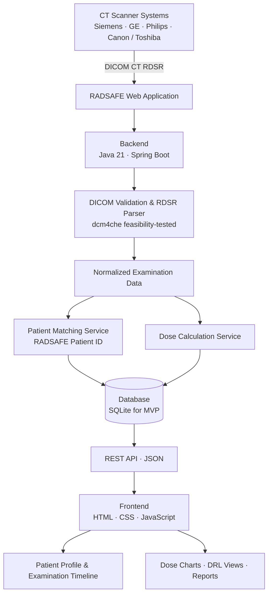
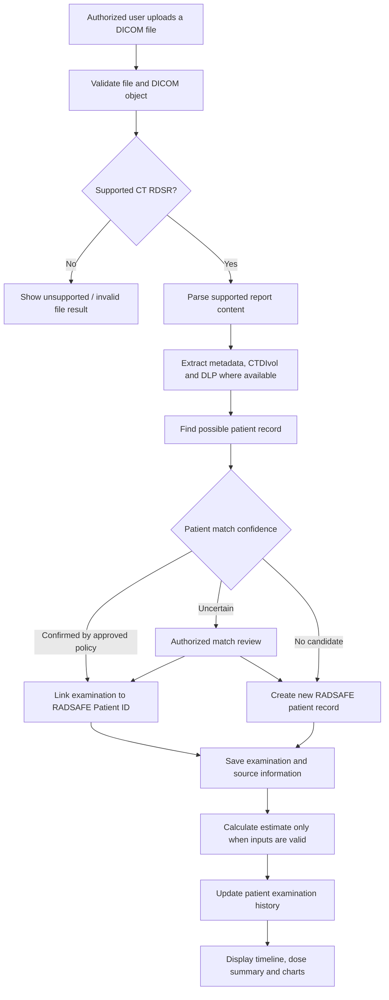

<div align="center">

# ☢️ RADSAFE

### Patient-Centric Longitudinal CT Radiation Dose Tracking & Analysis System

<p>
  
  
  
  
  
  
  
</p>

**One Patient. One RADSAFE ID. Complete CT Examination History.**

A vendor-neutral medical-informatics platform designed to collect supported CT Radiation Dose Structured Reports (RDSR), organize examinations under a longitudinal patient record, estimate radiation-dose indicators, and make the recorded history easier to review.

[Project Overview](#-project-overview) •
[Features](#-core-features) •
[Architecture](#-system-architecture) •
[Workflow](#-how-radsafe-works) •
[Scientific Model](#-scientific-dose-model) •
[Roadmap](#-roadmap) •
[Team](#-team) •
[Setup](#-getting-started)

</div>

---

## 🎯 Project Overview

CT examinations may take place at different times, hospitals, and scanner systems. Their radiation-dose information can therefore remain distributed across separate reports and institutions. Reviewing a patient's recorded CT history may require manually collecting examination information and dose indicators.

**RADSAFE aims to bring supported CT examination records together in one patient-centric system.**

Each RADSAFE patient record has an internal, persistent **RADSAFE Patient ID**. Multiple CT examinations can be linked to that record, allowing authorized users to review the available history chronologically and inspect the dose information associated with each examination.

### The problem we address

- CT examination records may be distributed across different visits and facilities.
- Scanner and institution identifiers are not necessarily consistent across sites.
- Dose indicators may require manual extraction and review.
- A patient's recorded examination history can be difficult to view as one timeline.
- Calculations need a traceable method, units, references, and validation.

### Our proposed solution

RADSAFE is designed to:

1. Ingest supported DICOM CT RDSR files.
2. Extract available examination metadata and dose indicators.
3. assign an internal RADSAFE Patient ID to each patient record.
4. Associate examinations with the correct patient through a controlled matching workflow.
5. Display the patient's available CT examination history in chronological order.
6. Estimate effective dose when the required data and an approved coefficient are available.
7. Summarize recorded estimates over time.
8. Support protocol-level DRL comparison and dose-history reporting.

> **Development status:** RADSAFE is an academic project under development. The features described here are target capabilities; they must not be assumed to be implemented or clinically validated unless explicitly demonstrated by tests.

---

## ✨ Core Features

| Feature | Description | Planned stage |
|---|---|---|
| DICOM RDSR Upload | Upload and validate supported CT RDSR files | MVP |
| Dose Data Extraction | Extract supported CTDIvol and DLP values with units and context | MVP |
| RADSAFE Patient ID | Assign an internal identifier to each patient record | MVP |
| Patient Matching | Associate examinations safely; send uncertain matches for review | MVP |
| Examination History | Display linked CT examinations chronologically | MVP |
| Effective Dose Estimation | Calculate estimates using approved, versioned conversion coefficients | MVP |
| Cumulative History | Summarize eligible examination estimates for the available record | MVP |
| Dashboard & Charts | Visualize records, examination history, and dose trends | MVP |
| DRL Comparison | Compare appropriate examination/protocol groups with suitable reference levels | Later MVP stage |
| Alerts | Provide configurable data-quality or reference-comparison notifications | Later MVP stage |
| PDF Radiation History | Export a traceable patient examination and dose-history report | Later MVP stage |

---

## 🏗️ System Architecture



### Main components

- **Frontend:** HTML5, CSS3, and vanilla JavaScript.
- **Backend:** Java 21 and Spring Boot REST APIs.
- **DICOM processing:** dcm4che, subject to proof-of-concept testing against representative CT RDSR files.
- **Database:** SQLite for the local MVP; PostgreSQL may be evaluated for a later multi-user deployment.
- **Charts:** Chart.js.
- **Design:** Figma, using the agreed light, hybrid dashboard direction.

---

## 🔄 How RADSAFE Works



### Patient-centric record

A patient's profile is intended to contain:

- Internal RADSAFE Patient ID.
- Recorded CT examinations in chronological order.
- Examination date and available institution/scanner/protocol information.
- CTDIvol and DLP values, with units and source context.
- Estimated effective dose when scientifically eligible.
- Cumulative sum of eligible estimates for the examinations available in RADSAFE.
- Parsing, validation, and patient-matching warnings.

### Patient identity and privacy

**RADSAFE Patient ID is an internal application identifier.** It is not the same as the Patient ID stored in a DICOM file.

A source DICOM Patient ID may only be unique within an institution or issuer. Therefore:

- Do not automatically merge patients across institutions using Patient ID or name alone.
- Use institution/issuer context and other approved matching evidence.
- Send uncertain matches to an authorized review workflow.
- Record matching and merge decisions.
- Display the internal RADSAFE Patient ID by default and mask direct identifiers where possible.
- Use de-identified or synthetic data during development and demonstrations.

---

## 🔬 Scientific Dose Model

### Dose metrics

| Metric | Unit | Meaning |
|---|---|---|
| CTDIvol | mGy | Standardized CT scanner output index; not a direct measurement of an individual patient's absorbed dose |
| DLP | mGy·cm | Dose-Length Product, commonly related to CTDIvol and scan length |
| Estimated Effective Dose | mSv | Radiation-protection estimate derived using an applicable conversion coefficient |

### Effective-dose estimate

When DLP, units, anatomical mapping, and an approved conversion coefficient are available:

\[
E_{\mathrm{estimated}}\;(\mathrm{mSv}) =
DLP\;(\mathrm{mGy \cdot cm}) \times k\;(\mathrm{mSv}/(\mathrm{mGy \cdot cm}))
\]

The cumulative estimate across eligible examinations is:

\[
E_{\mathrm{cumulative}} = \sum_{i=1}^{n} E_i
\]

**Scientific requirements**

- Every coefficient must have an exact reference, version, anatomical applicability, and population context.
- Do not assume one coefficient is suitable for every patient age, scan coverage, or protocol.
- If a value or mapping is missing or uncertain, show “Not calculated” or “Needs review”; do not invent a value or substitute zero.
- Preserve source dose metrics separately from derived estimates.
- Record the method and coefficient version used for each calculation.

> **Clinical disclaimer:** Effective dose is a radiation-protection quantity useful for broad comparisons. It is not an individualized prediction of a patient's health outcome, exact organ dose, or personal cancer risk. DRLs are optimization tools for appropriately defined examination groups, not dose limits for individual patients. RADSAFE is not a certified medical device and must not be used to make clinical decisions.

---

## 🗺️ Roadmap

| Phase | Timeline | Main focus | Expected outcome |
|---|---|---|---|
| **Phase 1 — Foundation & PoC** | Days 1–10 | Environment setup, sample RDSR investigation, UI wireframes, scientific data dictionary | Evidence that the chosen parser can inspect representative data; agreed architecture and prototype |
| **Phase 2 — Backend & Dose Engine** | Weeks 3–4 | Upload, parsing, database, patient matching, dose calculation, REST APIs | Testable backend workflow |
| **Phase 3 — Frontend & Integration** | Weeks 5–6 | Dashboard, upload, patient profile, history timeline, charts, API integration | Usable end-to-end prototype |
| **Phase 4 — Validation & Reporting** | Weeks 7–8 | Independent scientific validation, QA, appropriate DRL comparisons, PDF report | Demonstrable MVP with documented limitations |
| **Phase 5 — Future Extensions** | After MVP | PostgreSQL deployment, stronger access control, expanded vendor coverage, alerts, integrations | Carefully evaluated extension scope |

---

## 👥 Team

| Member | Role | Responsibilities |
|---|---|---|
| **Habiba** | Backend Developer & Coordinator | Java/Spring Boot, DICOM parser integration, database, patient matching, dose service integration, REST APIs, testing, coordination |
| **Manar** | UI/UX & Frontend Developer | Figma, design system, HTML/CSS/JavaScript, dashboard, upload flow, patient profile, charts, API integration |
| **Member 3** | Medical Physics Researcher | CT dose research, RDSR field dictionary, scientific references, k-factor review, DRL research, sample verification, independent calculation validation |

---

## 📁 Repository Structure

```text
RadSafe/
├── docs/
│   ├── project-scope.md
│   ├── SRS.md
│   ├── development-plan.md
│   ├── backend-plan.md
│   ├── frontend-plan.md
│   ├── ui-ux-guidelines.md
│   ├── medical-physics-research-plan.md
│   ├── user-flow.md
│   └── team-work-plan.md
│
├── backend/
│   └── ...
│
├── frontend/
│   └── ...
│
├── sample-data/
│   └── README.md
│
└── README.md
```

---

## 📚 Documentation Index

- [Project Scope](docs/project-scope.md) — vision, problem, goals, boundaries, privacy and safety.
- [Software Requirements Specification](docs/SRS.md) — functional and non-functional requirements, entities, APIs and acceptance criteria.
- [Development Plan](docs/development-plan.md) — phases, milestones, dependencies and risks.
- [Backend Plan](docs/backend-plan.md) — backend architecture, parsing, database, API and tests.
- [Frontend Plan](docs/frontend-plan.md) — pages, components, API integration and frontend acceptance.
- [UI/UX Guidelines](docs/ui-ux-guidelines.md) — light visual system, layouts, screens and accessibility.
- [Medical Physics Research Plan](docs/medical-physics-research-plan.md) — dose metrics, RDSR mapping, references, DRLs and validation.
- [User Flow](docs/user-flow.md) — upload, patient matching and patient-history journey.
- [Team Work Plan](docs/team-work-plan.md) — role ownership and the first 10-day sprint.

---

## 🚀 Getting Started

### Prerequisites

- JDK 21 or later.
- Maven 3.9+ or the repository Maven Wrapper.
- Git.
- A modern browser.

### Backend

```bash
git clone https://github.com/habibawaleid/RadSafe.git
cd RadSafe/backend

# Windows
mvnw.cmd spring-boot:run

# macOS / Linux
./mvnw spring-boot:run
```

The default local Spring Boot address is expected to be:

```text
http://localhost:8080
```

> Adjust the directory and commands to match the actual repository structure and committed Maven Wrapper. Do not assume the backend is runnable until the project files and configuration are present.

---

## 🧪 Validation Principles

Before a feature is considered complete:

1. Test with de-identified or synthetic sample data.
2. Compare extracted values and units against the source RDSR.
3. Compare dose calculations against independent Medical Physics calculations.
4. Verify patient matching and duplicate handling.
5. Test missing fields, unsupported reports, and ambiguous cases.
6. Document limitations and known unsupported report variations.

---

<div align="center">

**RADSAFE**

*Connecting recorded CT examinations into one traceable patient history.*

</div>
