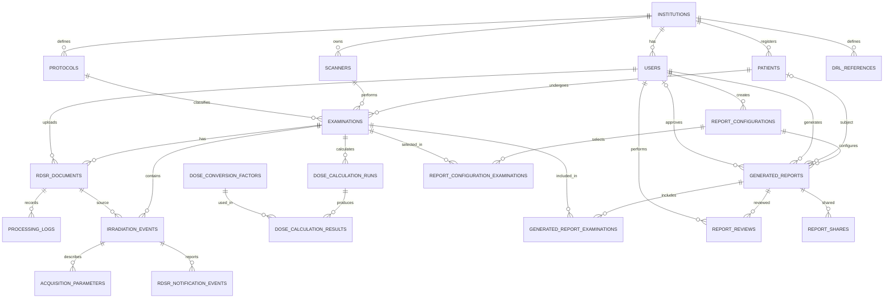

# RADSAFE — Database Plan
**Version:** 2.0  
**Updated:** 27 November 2026  
**Database:** MySQL 8.0+  
**Backend:** Java 21 + Spring Boot + Spring Data JPA  
**DICOM/RDSR:** dcm4che (validate against representative authorized RDSR samples)  
**Frontend:** HTML, CSS, JavaScript  
**Status:** Updated proposed blueprint — review before final SQL migrations

---

## 1. Purpose and scope

This document updates the RADSAFE database blueprint to align it with the approved Dashboard, DRL Comparison, and Reports UI revisions. Patient Dose Summary supports a selected group of examinations in the MVP.

RADSAFE is an academic/research prototype for importing CT DICOM Radiation Dose Structured Reports (RDSR), extracting available dose-related data, organizing examinations and irradiation events, supporting scientifically appropriate analysis, and generating reports for authorized users.

The MVP supports two report audiences:
1. **Medical Physicist / authorized professional:** technical examination reports, technical review, and grouped Dose Analytics / DRL reports.
2. **Patient:** a plain-language Patient Dose Summary for a selected group of examinations belonging to the same patient, generated and exported by authorized institutional staff. No patient login or portal is required in the MVP.

A Patient Dose Summary is informational; it is not a diagnostic report, a direct measurement of individual absorbed dose, or an individual risk assessment. The selected examination group must belong to one patient; the report must not combine examinations from different patients.

This is a proposed logical schema, not final SQL. Validate all source fields against the current Figma frames, representative RDSR samples, DICOM definitions, and the backend parser.

## 2. Confirmed project and UI scope

The ten agreed Figma pages remain:
1. Login
2. Medical Physicist Dashboard
3. Upload RDSR
4. Patients
5. Patient Profile
6. Examination Details
7. Dose Analytics
8. DRL Comparison
9. Reports Configuration
10. Report Preview / Review

The two report pages must support multiple report types without creating a separate patient portal.

### Dashboard and DRL Comparison data requirements

- **Dashboard — DRL Exceedance Summary:** derive a concise group-level summary from examinations/events that have a valid match to an applicable DRL reference. Show the number or proportion of eligible groups/protocol categories exceeding the reference, with the grouping and metric clearly identified. Do not classify an individual patient as passing or failing a DRL.
- **DRL Comparison — Selected DRL Reference Values:** retrieve the selected reference records from `drl_references`, including reference name, value, unit, source citation, version, and effective date where available.
- **DRL Comparison — DRL Comparison Table:** compare local group-level statistics with the matched reference values. Match metric, unit, body region/protocol category, and patient category as appropriate. Do not compare unlike metrics or units.
- **DRL Comparison — DRL Exceedance Summary:** derive the count/proportion of matched groups above the selected reference and show the applicable grouping context. This is a group-level analysis, not a patient-level alert or limit.
- These summaries are derived outputs, not new source measurements. Store the selected reference IDs, grouping criteria, metric/unit, calculation definitions, and resulting summary values in the generated report `data_snapshot` when they are included in a saved report.

### Scientific and UI constraints

- Missing, unsupported, or unreliable values are SQL `NULL` and displayed as **Not Available**. Never replace missing CTDIvol or DLP with zero.
- Preserve event-level measurements and source units; do not assume one CTDIvol/DLP value per examination or blindly sum event-level values.
- CTDIvol is a standardized scanner output index, not a direct patient-specific absorbed dose.
- Estimated effective dose is optional and only calculated when DLP, units, body region, conversion factor, and method are applicable and validated. Label it as an estimate.
- DRLs are for representative groups/protocols, not individual patient limits. Do not show patient-level DRL pass/fail.
- Only show notifications documented in the RDSR. Do not invent alert thresholds.
- Do not reintroduce removed Examination Details fields: Philips Dose Index or Image Quality Reference.
- Demo records are not real measurements. CTDIvol and DLP remain Not Available in the current demo set.
- Keep demo, authorized de-identified test, and future production data separated.
- RADSAFE is not a certified medical device and must not be used as the sole basis for patient-care decisions.

## 3. Report types and business rules

| Report type | Audience | Scope | MVP |
|---|---|---|---|
| `EXAMINATION_DOSE` | Medical Physicist | One examination | Yes |
| `PATIENT_DOSE_SUMMARY` | Patient | Group of examinations for one patient | Yes |
| `DOSE_ANALYTICS_DRL` | Medical Physicist / Management | Group of examinations | Yes |
| `PATIENT_DOSE_HISTORY` | Patient / authorized professional | Multiple examinations | Later phase |
| `DEPARTMENT_SCANNER_PERFORMANCE` | Management | Department/scanner | Later/basic extension |

### Patient Dose Summary content

May include, when available:
- Institution and report date.
- Patient identifier appropriate to institutional delivery policy; the same patient must be associated with every selected examination.
- Examination dates and types/body regions for all examinations in the selected group.
- Scanner and protocol information for the selected examinations, when available and appropriate.
- CTDIvol and DLP with units, clearly identified as reported indicators.
- Plain-language explanation of these indicators.
- Missing-data notes and source/provenance information.
- A statement that the document is informational, not a diagnostic report or individual risk assessment.

Do not include diagnosis, full medical history, treatment advice, or unsupported risk estimates. Do not expose unnecessary identifiers in exported files.

### Medical Physicist reports

May include patient/examination identifiers according to access permissions; scanner, protocol, RDSR source and processing status; event-level dose indicators and acquisition parameters; documented RDSR notification events; data-quality/missing-field information; applicable calculation results with method/version and source factor; DRL context only for appropriate grouped comparisons; and separate automated output from physicist-authored notes, assessment, and approval.

### Report workflow

1. Authorized user selects report type and scope in Reports Configuration.
2. For Patient Dose Summary, the user selects a group of examinations; the patient is derived from the selected examinations rather than chosen in a separate Patient Selection field.
3. Backend validates selection, scope, access, that all selected examinations belong to the same patient, and available source data.
4. System creates a preview from current source data and applicable calculations.
5. Medical Physicist reports may be reviewed and approved by an authorized Medical Physicist.
6. Patient Dose Summary is generated as a plain-language export for the selected examination group through an authorized institutional process.
7. Save/export with provenance and a data snapshot.
8. Sharing/delivery is authorized and audited if sharing is implemented.

Generation, review, approval, and sharing are distinct actions. `generated_by` is not equivalent to `approved_by`.

## 4. Proposed tables

The original 17-table foundation is retained. Report-related structures are expanded and two optional audit tables are added. Exact cardinalities remain subject to parser and Figma validation.

### 4.1 `institutions`
- `institution_id` BIGINT PK
- `institution_code` VARCHAR(50) UNIQUE
- `institution_name` VARCHAR(200) NOT NULL
- `address` VARCHAR(500) NULL
- `is_active` BOOLEAN NOT NULL DEFAULT TRUE
- `created_at`, `updated_at` DATETIME

### 4.2 `users`
- `user_id` BIGINT PK
- `institution_id` BIGINT FK
- `full_name` VARCHAR(150) NOT NULL
- `email` VARCHAR(190) NOT NULL UNIQUE
- `password_hash` VARCHAR(255) NOT NULL
- `role` VARCHAR(40) NOT NULL
- `is_active` BOOLEAN NOT NULL DEFAULT TRUE
- `created_at`, `updated_at` DATETIME

Suggested prototype roles: `MEDICAL_PHYSICIST`, `AUTHORIZED_STAFF`, `DEPARTMENT_MANAGER`, `ADMIN`. Enforce permissions in the backend; a UI dropdown is not authorization.

### 4.3 `patients`
- `patient_id` BIGINT PK
- `institution_id` BIGINT FK
- `dicom_patient_id` VARCHAR(128) NULL
- `patient_name` VARCHAR(200) NULL (sensitive; minimize use and restrict access)
- `date_of_birth` DATE NULL
- `sex` VARCHAR(20) NULL
- `created_at`, `updated_at` DATETIME

Do not assume a DICOM Patient ID is globally unique across institutions. Define institution-specific matching and duplicate rules. Never match across hospitals by name alone.

### 4.4 `scanners`
- `scanner_id` BIGINT PK
- `institution_id` BIGINT FK
- `manufacturer` VARCHAR(100) NULL
- `model_name` VARCHAR(150) NULL
- `station_name` VARCHAR(150) NULL
- `device_serial_number` VARCHAR(150) NULL
- `created_at`, `updated_at` DATETIME

### 4.5 `protocols`
- `protocol_id` BIGINT PK
- `institution_id` BIGINT FK
- `protocol_name` VARCHAR(200) NOT NULL
- `body_region` VARCHAR(100) NULL
- `patient_category` VARCHAR(50) NULL
- `created_at`, `updated_at` DATETIME

Protocol normalization requires Medical Physics review. Preserve original protocol text separately where sourced.

### 4.6 `examinations`
- `examination_id` BIGINT PK
- `patient_id` BIGINT FK
- `scanner_id` BIGINT FK NULL
- `protocol_id` BIGINT FK NULL
- `study_instance_uid` VARCHAR(128) NULL
- `accession_number` VARCHAR(128) NULL
- `study_date` DATE NULL
- `study_time` TIME NULL
- `study_description` VARCHAR(255) NULL
- `body_region` VARCHAR(100) NULL
- `exam_status` VARCHAR(30) NOT NULL
- `created_at`, `updated_at` DATETIME

Do not assume all fields exist in every RDSR. Define study/examination matching and duplicate rules before production use.

### 4.7 `rdsr_documents`
- `rdsr_document_id` BIGINT PK
- `examination_id` BIGINT FK NULL
- `uploaded_by` BIGINT FK
- `original_file_name` VARCHAR(255) NULL
- `storage_path` VARCHAR(500) NOT NULL
- `file_hash_sha256` CHAR(64) NOT NULL
- `sop_class_uid` VARCHAR(128) NULL
- `sop_instance_uid` VARCHAR(128) NULL
- `manufacturer` VARCHAR(100) NULL
- `processing_status` VARCHAR(30) NOT NULL
- `uploaded_at` DATETIME NOT NULL
- `processed_at` DATETIME NULL

Keep original RDSR files in access-controlled file/object storage, not as MySQL BLOBs by default. Define duplicate handling using file hash and DICOM identifiers.

### 4.8 `processing_logs`
- `processing_log_id` BIGINT PK
- `rdsr_document_id` BIGINT FK
- `log_level` VARCHAR(20) NOT NULL
- `stage` VARCHAR(80) NOT NULL
- `message` TEXT NULL
- `created_at` DATETIME NOT NULL

Do not log patient identifiers or full DICOM content unnecessarily.

### 4.9 `irradiation_events`
- `event_id` BIGINT PK
- `examination_id` BIGINT FK
- `rdsr_document_id` BIGINT FK
- `source_event_identifier` VARCHAR(150) NULL
- `event_type` VARCHAR(100) NULL
- `event_start_datetime` DATETIME NULL
- `target_region` VARCHAR(100) NULL
- `ctdi_vol_value` DECIMAL(12,5) NULL
- `ctdi_vol_unit` VARCHAR(30) NULL
- `dlp_value` DECIMAL(14,5) NULL
- `dlp_unit` VARCHAR(30) NULL
- `phantom_type` VARCHAR(50) NULL
- `scan_length_value` DECIMAL(12,5) NULL
- `scan_length_unit` VARCHAR(30) NULL
- `source_content_reference` VARCHAR(255) NULL

Keep original/source representation and normalized value/unit traceable. Confirm mapping against actual RDSR samples.

### 4.10 `acquisition_parameters`
- `acquisition_parameter_id` BIGINT PK
- `event_id` BIGINT FK
- `kVp` DECIMAL(8,3) NULL
- `tube_current_mA` DECIMAL(10,3) NULL
- `exposure_time_ms` DECIMAL(12,3) NULL
- `pitch_factor` DECIMAL(10,5) NULL
- `rotation_time_s` DECIMAL(10,5) NULL
- `other_parameters_json` JSON NULL

Do not enforce one-to-one cardinality until real RDSR structures and parameter groups have been inspected.

### 4.11 `rdsr_notification_events`
- `notification_event_id` BIGINT PK
- `examination_id` BIGINT FK
- `event_id` BIGINT FK NULL
- `rdsr_document_id` BIGINT FK
- `notification_code` VARCHAR(100) NULL
- `notification_description` TEXT NULL
- `notification_datetime` DATETIME NULL

Only persist notifications actually documented in the source.

### 4.12 `dose_conversion_factors`
- `conversion_factor_id` BIGINT PK
- `body_region` VARCHAR(100) NOT NULL
- `patient_category` VARCHAR(50) NULL
- `factor_value` DECIMAL(14,8) NOT NULL
- `factor_unit` VARCHAR(100) NOT NULL
- `reference_name` VARCHAR(255) NOT NULL
- `reference_version` VARCHAR(100) NULL
- `valid_from` DATE NULL
- `valid_to` DATE NULL
- `is_active` BOOLEAN NOT NULL DEFAULT TRUE

A factor must not be selected merely because a body-region label looks similar. Applicability and source require review.

### 4.13 `dose_calculation_runs`
- `calculation_run_id` BIGINT PK
- `examination_id` BIGINT FK
- `calculation_method` VARCHAR(100) NOT NULL
- `methodology_version` VARCHAR(50) NOT NULL
- `run_status` VARCHAR(30) NOT NULL
- `calculated_at` DATETIME NOT NULL
- `calculated_by` BIGINT FK NULL

### 4.14 `dose_calculation_results`
- `calculation_result_id` BIGINT PK
- `calculation_run_id` BIGINT FK
- `event_id` BIGINT FK NULL
- `conversion_factor_id` BIGINT FK NULL
- `metric_code` VARCHAR(80) NOT NULL
- `result_value` DECIMAL(16,8) NULL
- `result_unit` VARCHAR(50) NULL
- `input_values_json` JSON NULL
- `result_status` VARCHAR(30) NOT NULL
- `limitation_note` TEXT NULL

Store only validated calculation results. Missing/invalid input means a non-success status and NULL result, not zero.

### 4.15 `drl_references`
- `drl_reference_id` BIGINT PK
- `institution_id` BIGINT FK NULL
- `reference_name` VARCHAR(255) NOT NULL
- `body_region` VARCHAR(100) NOT NULL
- `protocol_category` VARCHAR(150) NULL
- `patient_category` VARCHAR(50) NULL
- `metric_code` VARCHAR(80) NOT NULL
- `reference_value` DECIMAL(16,6) NOT NULL
- `reference_unit` VARCHAR(50) NOT NULL
- `source_citation` VARCHAR(500) NOT NULL
- `reference_version` VARCHAR(100) NULL
- `effective_date` DATE NULL
- `is_active` BOOLEAN NOT NULL DEFAULT TRUE

DRL comparison is group-level and must match metric, units, protocol/body region, and patient category as appropriate. Never compare one patient's value to a DRL as a patient limit.

### 4.16 `report_configurations`
Stores reusable report setup, not the final report.
- `configuration_id` BIGINT PK
- `created_by` BIGINT FK
- `configuration_name` VARCHAR(200) NOT NULL
- `report_type` VARCHAR(50) NOT NULL
- `report_scope` VARCHAR(30) NOT NULL
- `audience` VARCHAR(40) NOT NULL
- `selected_sections` JSON NULL
- `filters` JSON NULL
- `language` VARCHAR(10) NOT NULL DEFAULT 'en'
- `report_format` VARCHAR(20) NOT NULL DEFAULT 'PDF'
- `is_default` BOOLEAN NOT NULL DEFAULT FALSE
- `created_at`, `updated_at` DATETIME

MVP values:
- `report_type`: `EXAMINATION_DOSE`, `PATIENT_DOSE_SUMMARY`, `DOSE_ANALYTICS_DRL`
- `report_scope`: `EXAMINATION`, `GROUP`
- `PATIENT_DOSE_SUMMARY` uses `GROUP`; `EXAMINATION_DOSE` uses `EXAMINATION`; `DOSE_ANALYTICS_DRL` uses `GROUP`.
- `audience`: `MEDICAL_PHYSICIST`, `PATIENT`, `MANAGEMENT`

Validate JSON structure and enum values in the backend. Do not put core patient/examination data into JSON.

### 4.17 `generated_reports`
Stores each report instance that is saved/generated. The exact examination membership is stored in `generated_report_examinations`, rather than in one `examination_id` column.
- `report_id` BIGINT PK
- `configuration_id` BIGINT FK NULL
- `report_type` VARCHAR(50) NOT NULL
- `report_scope` VARCHAR(30) NOT NULL
- `audience` VARCHAR(40) NOT NULL
- `patient_id` BIGINT FK NULL (set for Patient Dose Summary; NULL for group analytics)
- `generated_by` BIGINT FK NOT NULL
- `approved_by` BIGINT FK NULL
- `report_title` VARCHAR(200) NOT NULL
- `report_format` VARCHAR(20) NOT NULL
- `storage_path` VARCHAR(500) NULL
- `generation_status` VARCHAR(30) NOT NULL
- `review_status` VARCHAR(30) NOT NULL
- `data_snapshot` JSON NOT NULL
- `methodology_version` VARCHAR(50) NULL
- `generated_at` DATETIME NOT NULL
- `approved_at` DATETIME NULL

Important rules:
- Keep report type, scope, audience, and source links on the report record as a historical snapshot of what was generated.
- `data_snapshot` captures exact source values, units, source document/event references, calculation results/method version, missing-data state, and relevant content inputs used at generation time.
- Snapshot does not replace normalized source tables.
- A preview never saved may remain transient and need not create a `generated_reports` row.
- For `PATIENT_DOSE_SUMMARY`, require `patient_id` and at least one linked examination through `generated_report_examinations`; validate that every linked examination belongs to that patient.
- For `EXAMINATION_DOSE`, require exactly one linked examination through `generated_report_examinations`.
- For `DOSE_ANALYTICS_DRL`, link the exact included examinations through `generated_report_examinations`; `patient_id` is NULL because the report is a group-level analysis and may include multiple patients.
- Preserve exact selected examination IDs, filters, and included source record IDs in the snapshot.
- Enforce conditional rules in application validation and, where practical, database constraints/triggers.

### 4.18 `report_reviews` (recommended if formal review is shown in Figma)
- `report_review_id` BIGINT PK
- `report_id` BIGINT FK
- `reviewed_by` BIGINT FK
- `review_action` VARCHAR(30) NOT NULL
- `review_status` VARCHAR(30) NOT NULL
- `review_notes` TEXT NULL
- `reviewed_at` DATETIME NOT NULL

Possible actions: `SUBMIT_FOR_REVIEW`, `REQUEST_CHANGES`, `APPROVE`, `REJECT`. Define which report types require professional approval. Patient-facing approval must not imply diagnosis or risk assessment.

### 4.19 `report_shares` (optional; only if explicit share/delivery tracking is implemented)
- `report_share_id` BIGINT PK
- `report_id` BIGINT FK
- `shared_by` BIGINT FK
- `recipient_type` VARCHAR(40) NOT NULL
- `recipient_reference` VARCHAR(255) NULL
- `delivery_method` VARCHAR(40) NOT NULL
- `share_status` VARCHAR(30) NOT NULL
- `shared_at` DATETIME NULL
- `expires_at` DATETIME NULL
- `accessed_at` DATETIME NULL

Do not store public permanent links. If sharing is not implemented in MVP, defer this table and use the institution's controlled manual delivery process.

### 4.20 `report_configuration_examinations` (required for explicit examination-group selection)
Stores the examinations selected in a saved report configuration.
- `configuration_id` BIGINT FK
- `examination_id` BIGINT FK
- `created_at` DATETIME NOT NULL
- Primary key: (`configuration_id`, `examination_id`)

Use this junction table for the Patient Dose Summary group selection and, where the UI supports explicit selection, for other report configurations. Do not store core examination IDs only inside JSON. The backend must validate that all examinations selected for a Patient Dose Summary belong to the same patient.

### 4.21 `generated_report_examinations` (required report membership snapshot)
Stores the exact examinations included in each generated report.
- `report_id` BIGINT FK
- `examination_id` BIGINT FK
- `created_at` DATETIME NOT NULL
- Primary key: (`report_id`, `examination_id`)

This table preserves the report's exact examination membership even if the reusable configuration is later edited. For `EXAMINATION_DOSE`, exactly one examination is linked. For `PATIENT_DOSE_SUMMARY`, one or more examinations belonging to the same patient are linked. For `DOSE_ANALYTICS_DRL`, link all examinations included by the selected filters/group; the report may cover multiple patients.

## 5. ERD — report-related relationships

The diagram is logical. Validate optional relationships, cardinalities, and delete rules before implementation. `report_shares` is optional and can be deferred.

## 6. Figma-to-database mapping

| Figma page | Main database sources |
|---|---|
| Login | `users`, `institutions` |
| Medical Physicist Dashboard | `examinations`, `patients`, `irradiation_events`, `rdsr_documents`, `processing_logs`, `drl_references` (for DRL Exceedance Summary) |
| Upload RDSR | `rdsr_documents`, `processing_logs` |
| Patients | `patients`, `institutions`, `examinations` |
| Patient Profile | `patients`, `examinations`, `rdsr_documents`, `generated_reports` |
| Examination Details | `examinations`, `irradiation_events`, `acquisition_parameters`, `rdsr_notification_events` |
| Dose Analytics | `irradiation_events`, `examinations`, `protocols`, calculation results where applicable |
| DRL Comparison | `irradiation_events`, `examinations`, `protocols`, `drl_references`; grouped comparison calculations and DRL Exceedance Summary are derived from matched group data |
| Reports Configuration | `report_configurations` and validated source data |
| Report Preview / Review | `generated_reports`, `generated_report_examinations`, source tables, calculation results, `report_reviews`; `report_shares` only if implemented |

### Reports Configuration UI requirements
- Select report type.
- Select audience (constrained by report type).
- Select scope and target: a group of examinations for Patient Dose Summary; one examination for Examination Dose Report; filters/date range or a selected examination group for Dose Analytics / DRL.
- Do not show separate Patient Selection and Examination Selection controls for Patient Dose Summary; provide one group-of-examinations selection. Validate that the selected examinations belong to one patient.
- Select sections and language.
- Validate missing/unavailable source data before preview.
- No Patient Portal or patient login in MVP.

### Report Preview / Review UI requirements
- Patient-friendly layout for Patient Dose Summary; technical layout for Medical Physicist reports.
- The Patient Dose Summary preview must identify the selected examination group and use the group as its reporting scope.
- Replace the old helper text “One patient / One selected examination” with wording that indicates “Group of examinations”.
- Clearly identify unavailable values.
- Distinguish source-extracted values, derived group statistics, calculated estimates, and human-authored review notes.
- Show status and reviewer only when relevant.
- Keep export/save actions permission-controlled.
- Show institution and source provenance.
- Patient report must not contain unsupported risk statements or patient-level DRL pass/fail.

## 7. Data storage and calculation rules

- Use `DECIMAL` for persisted scientific numeric values, not `FLOAT`.
- Preserve source units and store normalized units only with traceable conversion.
- Preserve event-level dose metrics.
- Store derived group statistics as query results or report snapshot values with definitions; do not represent them as source measurements.
- Store calculated values with method, factor reference, version, timestamp, and inputs.
- Use NULL for missing/unsupported values.
- Do not infer a missing value from another event/examination unless a documented method explicitly allows it.
- Keep original RDSR outside the relational database by default; store protected path and SHA-256 hash.

## 8. MySQL conventions and indexes

- Engine: InnoDB; charset: utf8mb4; PKs: BIGINT AUTO_INCREMENT; enforce foreign keys.
- Names: lowercase snake_case.
- Date: DATE; time: TIME; timestamp: DATETIME with agreed timezone policy.
- JSON only for flexible configuration/snapshot payloads, not core relational entities.
- Candidate indexes:
  - `users(email)` UNIQUE; `users(institution_id)`
  - `patients(institution_id, dicom_patient_id)` subject to matching policy
  - `examinations(patient_id, study_date)`, `study_instance_uid`
  - `rdsr_documents(examination_id, uploaded_at)`, `file_hash_sha256`
  - `irradiation_events(examination_id)`, `rdsr_document_id`
  - `dose_calculation_runs(examination_id, calculated_at)`
  - `dose_calculation_results(calculation_run_id, metric_code)`
  - `drl_references(body_region, patient_category, metric_code)`
  - `report_configurations(created_by, report_type)`
  - `report_configuration_examinations(examination_id, configuration_id)`
  - `generated_report_examinations(examination_id, report_id)`
  - `generated_reports(generated_by, generated_at)`, `(patient_id, generated_at)`, `(examination_id, generated_at)`, `(report_type, generated_at)`
  - `report_reviews(report_id, reviewed_at)`
  - `report_shares(report_id, shared_at)` if implemented

Confirm indexes against actual queries; do not index every column.

### Delete and transaction policy
- Avoid cascading deletion of patient/examination/source data by default.
- Prefer controlled archival/deactivation.
- Persist parser output transactionally so a failed parse does not leave partial event records.
- Define retention/deletion policy before handling identifiable real data.

## 9. Security and privacy

- Restrict records by institution and user permissions at backend/API level.
- Restrict original RDSR and generated report file access.
- Use secure password hashing; never store plaintext passwords.
- Do not commit identifiable RDSR, patient reports, passwords, or `.env` files to GitHub.
- Use synthetic/public/properly de-identified data for development.
- Minimize identifiers in Patient Dose Summary and apply institution-approved delivery procedures.
- If report sharing is implemented, record recipient/delivery/access metadata and avoid public unprotected links.
- Avoid patient identifiers in application logs.
- Define backup, retention, access, and deletion rules before production.

## 10. Demo data policy

- Existing seven demo cases remain clearly marked as demo.
- Demo records must not be interpreted as real RDSR measurements.
- CTDIvol and DLP remain NULL and display as Not Available.
- Do not use demo records to validate parsing, scientific calculations, or DRL logic.
- Use separate authorized de-identified RDSR fixtures for parser and scientific validation.

## 11. Implementation phases

### Phase 1 — core data and parsing
1. Institutions/users.
2. Patients/examinations/scanners/protocols.
3. RDSR documents and processing logs.
4. Irradiation events, acquisition parameters, notification events.
5. Validate parser using representative authorized samples.

### Phase 2 — scientific analysis
1. Calculation factors and calculation runs/results.
2. DRL references and group comparison rules.
3. Medical Physics review of units, aggregation, and methodology.

### Phase 3 — MVP reporting
1. Update `report_configurations` and add normalized examination-selection links for report configurations.
2. Implement `generated_reports` with report type, scope, audience, linked examinations, and snapshot.
3. Implement Examination Dose Report.
4. Implement Patient Dose Summary PDF export.
5. Implement Dose Analytics & DRL report.
6. Implement basic Medical Physicist review using `report_reviews` if Figma requires formal review.
7. Defer `report_shares` unless secure sharing is explicitly included in MVP.

### Later phase
- Patient Dose History across multiple examinations.
- Patient portal/account.
- Secure inter-institution exchange/import and identity reconciliation.
- Department/scanner performance reporting.
- Advanced access/audit workflows as required.

## 12. Team responsibilities

- **Member 1 — Backend, database, testing, coordination:** schema, migrations, Spring entities/repositories, parser integration, APIs, report generation, integration tests.
- **Member 2 — UI/UX and frontend:** maintain Figma, implement HTML/CSS/JavaScript, patient/physicist report layouts, display unavailable values, integrate APIs.
- **Member 3 — Medical Physics and research:** verify source fields and units, review CTDIvol/DLP interpretation, conversion factors, DRL grouping, report wording, and manual validation examples.

## 13. Required tests

### Report tests
- Patient Dose Summary requires a selected group of examinations, all belonging to the same patient; the patient is derived from the selected examinations.
- Patient Dose Summary preview text identifies a group of examinations (not “One patient / One selected examination”).
- Patient report cannot include another patient's data.
- Patient report shows Not Available for missing CTDIvol/DLP.
- Patient report does not show unsupported individual risk or patient-level DRL pass/fail.
- Technical report includes available event-level values and source references.
- Report type/audience/scope combinations are validated.
- Generated report snapshot remains unchanged after later source reprocessing.
- `generated_by` and `approved_by` remain distinct.
- Unauthorized users cannot generate, approve, view, export, or share restricted reports.
- Group report preserves filters and exact included source records.
- Failed report generation does not leave a falsely successful report record.

### Parser/scientific tests
- Valid RDSR, non-DICOM, non-RDSR, malformed/unsupported file.
- Duplicate file upload.
- Multiple irradiation events.
- Missing dose metrics and acquisition parameters.
- Documented notification events.
- Units, event-level versus examination-level handling, conversion factor applicability, DRL group classification, and manual calculation agreement.

## 14. Open decisions before final SQL

1. Exact report sections and language options in latest Figma frames.
2. Whether formal review is mandatory for every Medical Physicist report or selected types only.
3. Whether `report_shares` is in MVP or deferred to controlled manual delivery.
4. Exact patient identifier policy on Patient Dose Summary.
5. Report snapshot format and storage limits.
6. Parser mapping and cardinality validated against real RDSR samples.
7. Institution-specific patient/examination matching rules.
8. Retention and deletion policy.

Do not create final SQL migrations until these decisions and the real RDSR parser feasibility gate are reviewed.

## 15. Revision history

| Version | Date | Changes |
|---|---|---|
| 1.0 | 23 Nov 2026 | Initial proposed database blueprint aligned with ten Figma pages. |
| 2.0 | 24 Nov 2026 | Added Patient Dose Summary as an MVP report type; expanded report configuration and generated report metadata; added review workflow and optional sharing structure; updated Figma mapping, business rules, security, and tests. |
| 2.1 | 27 Nov 2026 | Aligned Dashboard and DRL Comparison data requirements with the revision table; removed Medical Physicist Technical Review as a selectable report type; changed Patient Dose Summary to a same-patient group of examinations; added normalized configuration and generated-report examination links. |

---

**Implementation principle:** the database stores source facts and traceable outputs. The interface may explain those facts differently for a Medical Physicist and a patient, but it must never change the underlying measurement, hide missing data, or imply unsupported clinical conclusions.
